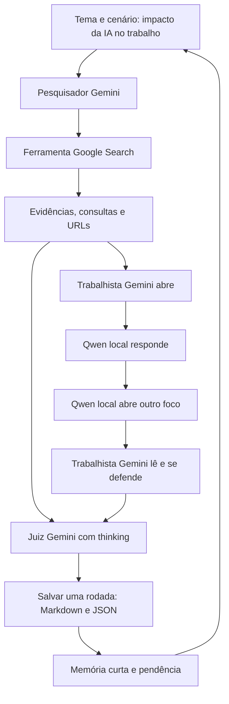

# ARN-C — arena dialética sobre IA e trabalho

**Andreza Maria Coutinho Falcão · pt-BR · artefato `arn·c`**

Arena com trabalhista remoto, liberal Qwen local, juiz remoto e pesquisador com busca web. Propósito, limitações e seleção dos resultados: [CONTEXT.md](CONTEXT.md).

## São vinte rodadas, sem misturar refações

O conjunto selecionado está **somente** em [resultados/ultima_execucao](resultados/ultima_execucao/indice_rodadas.md).

- **20 rodadas**, numeradas 01 a 20.
- **20 Markdown + 20 JSON:** dois formatos da mesma rodada, não quarenta rodadas.
- **40 turnos Qwen:** duas intervenções locais por rodada, não quarenta rodadas.
- **64 requisições históricas:** incluem novas tentativas, não sessenta e quatro rodadas.
- **26 slides** em `materiais/`: páginas de apresentação, não rodadas adicionais.

As pastas redundantes `entradas`, `intercambio`, `julgamentos` e `chamadas_locais` foram retiradas do módulo. As informações necessárias já estão dentro dos vinte JSONs canônicos. Incidentes antigos e refações anteriores não foram incluídos.

**Importante:** os resultados preservados são protocolo 4. O código posterior encontrado era v5. O executor atualizado é v6 e **não foi executado para substituir esses resultados**. O [manifesto](resultados/ultima_execucao/manifesto.json) identifica o conjunto e seus hashes.

## Os cinco itens da rubrica

| Item | Situação atual | Evidência |
|---|---|---|
| 1. Diretório isolado e contexto | Documentado | `CONTEXT.md` |
| 2. Diagrama, papéis e comunicação | Documentado | Diagrama abaixo e protocolo no contexto |
| 3. Prompts e parâmetros por agente | Especificado e consumido pelo executor | `prompts/`, `configuracao.json`, `docs/PROMPTS_PARAMETROS.md` |
| 4. Busca web durante a execução | Integração implementada; validação externa pendente | `agentes_remotos.py`, ferramenta `google_search` e exigência de metadados reais |
| 5. Thinking e reflexão crítica | Configuração e chamadas implementadas; atuação externa pendente | `thinkingConfig`, metadados de uso e perfil do juiz |

**Não declarar 10/10 comprovados:** os registros antigos não evidenciam 4/5. É necessária uma execução autenticada do novo código, com consultas, fontes e uso de thinking registrados. Não há `GEMINI_API_KEY` configurada nesta revisão. Detalhes: [docs/CRITERIOS.md](docs/CRITERIOS.md).

## Diagrama de papéis e fluxo



Trabalhista e juiz são chamadas remotas com perfis distintos. O pesquisador é um agente de suporte. O Qwen é o participante local. Cada etapa espera as mensagens de que depende; o juiz não usa pareceres pré-escritos.

## Estrutura

```text
arn-c/
├── CONTEXT.md
├── README.md
├── executar_debate.py       # auditagem local ou nova execução real
├── agentes_remotos.py       # API Gemini, Google Search e thinking
├── ponte_debate.py          # Ollama e controles locais
├── configuracao.json        # vinte temas, cenários e parâmetros
├── prompts/                 # quatro prompts de sistema carregados pelo código
├── docs/                    # rubrica, parâmetros e referências técnicas
├── resultados/ultima_execucao/
│   ├── manifesto.json       # seleção e integridade dos vinte registros
│   ├── indice_rodadas.md
│   ├── execucao.json
│   └── rodadas/             # somente 01–20, em .md e .json
├── materiais/               # apresentação anterior, imagens e roteiro
└── criar_apresentacao.mjs    # gerador opcional dos materiais anteriores
```

## Conferir o conjunto salvo sem gerar novas rodadas

```bash
cd arn-c
python3 executar_debate.py --auditar
```

Esse comando não consulta modelos nem a web. Confere sequência 01–20, correspondência dos formatos, hashes e contagens. Não reclassifica metadados antigos como capacidades novas.

## Executar o protocolo novo com pesquisa e thinking

Requisitos: Python 3.10+, Ollama com `qwen2.5:1.5b`, acesso à internet e credencial da API Gemini com acesso ao modelo e à busca. O código Python usa apenas a biblioteca padrão.

```bash
ollama pull qwen2.5:1.5b
# Inicie o Ollama, se ainda não estiver ativo.
cp .env.example .env
# Preencha a credencial somente no seu arquivo local .env, ignorado pelo Git.
source .env
python3 executar_debate.py --executar --cenario utopia --saida execucoes/utopia
```

A configuração padrão remota é `gemini-2.5-flash`. `GEMINI_MODEL` permite selecionar outro modelo compatível com o adaptador; disponibilidade e cotas dependem da conta. A execução faz chamadas à API e à busca, que podem ter cobrança. Sem credencial, o comando interrompe antes de gerar rodadas.

Para outro cenário, use outro diretório, sem compartilhar memória:

```bash
python3 executar_debate.py --executar --cenario distopia --saida execucoes/distopia
```

Cada comando executa vinte rodadas. **Eles não foram rodados nesta revisão.** Distopia trata de riscos e prevenção de efeitos adversos da IA.

Retomada de uma execução interrompida, com a mesma configuração e código:

```bash
python3 executar_debate.py --executar --cenario utopia --saida execucoes/utopia --retomar
```

O programa preserva a execução selecionada e recusa sobrescrevê-la. Novos resultados ficam fora dela. Arquivos em `execucoes/` são ignorados pelo Git até serem revisados e selecionados explicitamente.

## Apresentação preservada

O PPTX e o roteiro ficam em `materiais/`. Não foram reeditados para alegar busca ou thinking. O gerador opcional requer Node.js e `@oai/artifact-tool`, disponível no ambiente original de autoria, e lê por padrão `resultados/ultima_execucao`. A dependência de slides não é necessária para a arena Python.

```bash
node criar_apresentacao.mjs
```

Esse comando substitui os materiais gerados; não é necessário para consultar as vinte rodadas. O gerador anterior ainda contém textos fixos da apresentação original e não serve como comprovação automática das novas capacidades.
