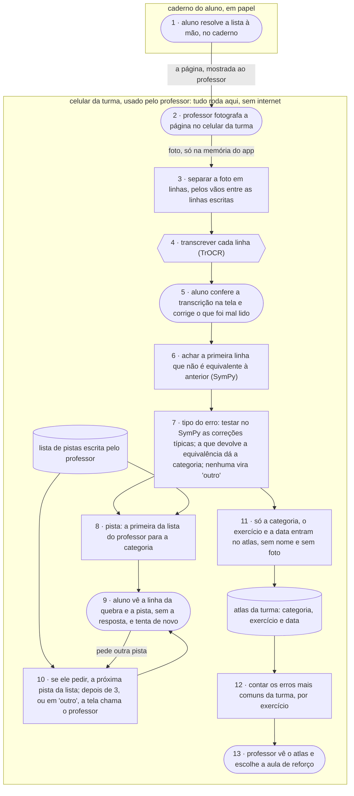

# Atlas do Erro · fluxograma e arquitetura

O caminho de uma resolução, do caderno do aluno até a pista que volta para ele e o atlas que
volta para o professor. Artefato **fluxograma e arquitetura** (`flx`) da disciplina AI4Good;
a folha está em [flx.md](flx.md).

Formas: **pessoa** `([ ])` · **IA** `{{ }}` · **regra** `[ ]`. Caixas: onde cada peça roda.

## os dados

| dado pessoal | de quem é | onde fica | quem vê | por quanto tempo |
|:--|:--|:--|:--|:--|
| foto da página (a letra do aluno, e o nome, se estiver escrito no caderno) | aluno | memória do app, no celular da turma; não vai para a galeria | aluno e professor, na tela | até o aluno conferir a transcrição (passo 5); o app apaga |
| transcrição das linhas | aluno | memória do app | aluno e professor, na tela | até o fim do exercício |
| nome do aluno | aluno | não é guardado | ninguém | nunca é registrado |
| categoria do erro, exercício, data e número de pistas pedidas | da turma, sem nome | atlas, no celular da turma | professor | até o fim do bimestre; depois, fica só a contagem por categoria |

Nada sai do celular da turma. A foto é tirada pela câmera do próprio app e não passa pela
galeria, para não entrar no backup automático do celular.
