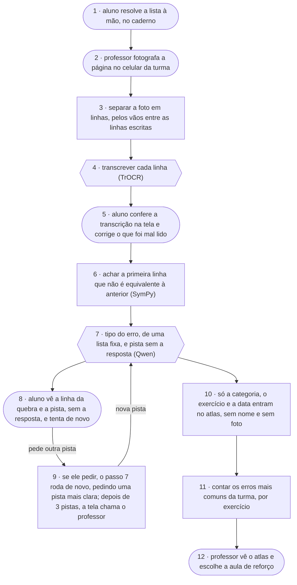

# Atlas do Erro · fluxograma e arquitetura

O caminho de uma resolução, do caderno do aluno até a pista que volta para ele e o atlas que
volta para o professor. Artefato **fluxograma e arquitetura** (`flx`) da disciplina AI4Good;
a folha está em [flx.md](flx.md).

Formas: **pessoa** `([ ])` · **IA** `{{ }}` · **regra** `[ ]`.

