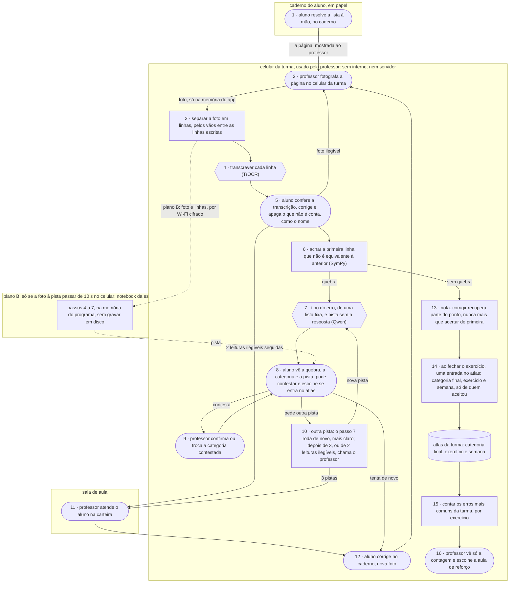

# Atlas do Erro · fluxograma e arquitetura

O caminho de uma resolução, do caderno do aluno até a pista e a nota que voltam para ele e o
atlas que volta para o professor. Artefato **fluxograma e arquitetura** (`flx`) da disciplina
AI4Good; a folha está em [flx.md](flx.md).

Formas: **pessoa** `([ ])` · **IA** `{{ }}` · **regra** `[ ]`. Caixas: onde cada peça roda.

## os dados

| dado pessoal | de quem é | onde fica | quem vê | por quanto tempo |
|:--|:--|:--|:--|:--|
| foto da página (a letra do aluno, e o nome, se estiver escrito no caderno) | aluno | memória do app, no celular da turma, sem passar pela galeria; no plano B, memória do programa no notebook | aluno e professor, na tela | até o aluno conferir a transcrição (passo 5); o app apaga |
| transcrição das linhas | aluno | memória do app e do Qwen | aluno e professor, na tela | até o exercício fechar; o nome escrito no caderno é apagado pelo aluno no passo 5 |
| categoria, pista e contestação | aluno | memória do app | aluno e professor, na tela | até o exercício fechar; só a categoria final vai para o atlas |
| nome do aluno | aluno | não é guardado | ninguém | nunca é registrado |
| entrada no atlas: categoria final, exercício e semana | da turma, sem nome | atlas, no celular da turma | professor, só a contagem | até o fim do bimestre; só de quem aceitou |

No caminho principal, nada sai do celular da turma, e o app desliga o backup automático dos
próprios dados. No plano B, a foto e as linhas vão pelo Wi-Fi da escola, cifradas, até o notebook,
ficam só na memória do programa e não vão para a internet.
